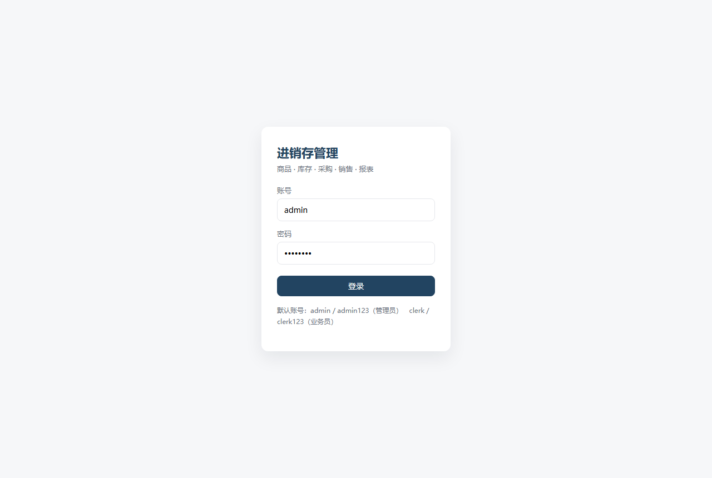
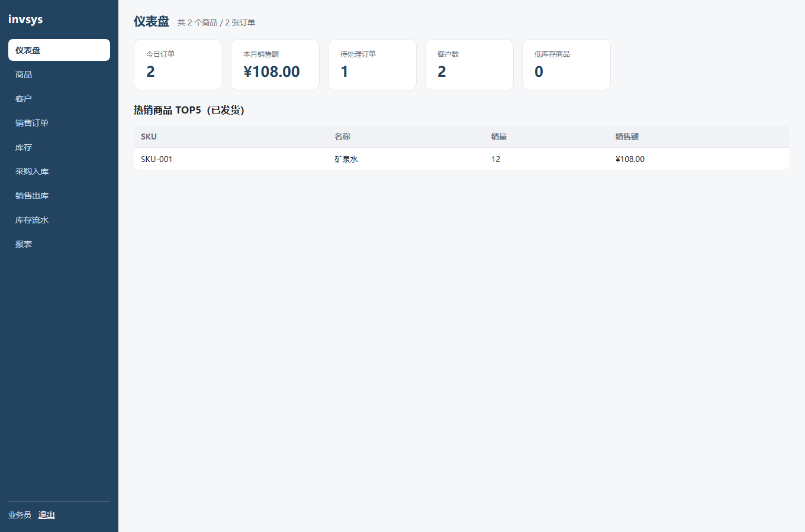
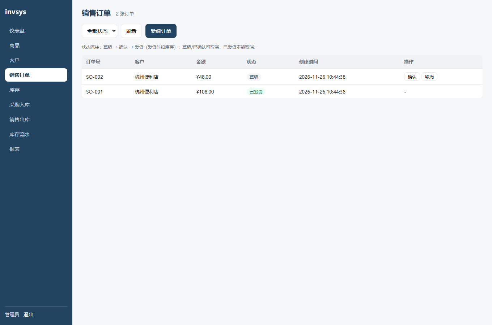

# 进销存后端（invsys）


一个开箱可跑的**采购-库存-销售**后端服务，只用 Python 标准库
（`http.server` + `sqlite3` + `unittest`），按 `db → service → api` 三层组织。

业务模块参考了开源 ERP [jshERP](https://github.com/jishenghua/jshERP) 的划分：
**仪表盘 / 客户 / 商品 / 销售订单 / 仓库 / 库存 / 采购入库 / 盘点 / 报表**。

## 自带网页管理端

启动服务后浏览器打开 http://127.0.0.1:8000/ 就能用，**不需要 npm、不需要构建**：



- 登录后左侧导航：**仪表盘 / 商品 / 客户 / 销售订单 / 库存 / 采购入库 / 销售出库 / 库存流水 / 报表**



- 前端就是三个文件（web/index.html + style.css + pp.js，共 411 行原生 JS）
- 由 pi.py 直接托管静态资源，带目录穿越防护和 MIME 类型

这样整个系统只有一个 Python 进程、一个 SQLite 文件——拷到内网机器上就能跑。

## 这个项目解决的真实问题

普通示例只做 CRUD，这个项目处理了三件真实系统才会遇到的事：

| 问题 | 做法 |
|---|---|
| **超卖**（并发扣库存） | 一条带条件的 `UPDATE ... WHERE qty >= ?` 原子扣减，扣不动就整单回滚 |
| **重复提交**（网络重试） | 单据号唯一约束，重复单号返回 409 |
| **对账**（库存怎么变的） | 每次变动写流水，记录 `qty_before / qty_after / 单据号` |

并发是有测试证明的：10 个线程同时买 1 件、库存 5 件，**恰好 5 个成功、5 个 409、最终库存 0**。

## 环境与运行

- Python 3.9+（实测 3.12），无第三方依赖

```bash
python -m invsys --port 8000 --db invsys.db
# listening on http://127.0.0.1:8000
# schema: 0 -> 2
# 默认账号：admin/admin123（管理员）、clerk/clerk123（业务员）
```

数据库**自动迁移**：启动时读取 `schema_version`，只执行未应用的迁移（当前到 v2）。

## 接口

| 方法 | 路径 | 说明 | 权限 |
|---|---|---|---|
| GET | `/api/health` | 健康检查（含 schema 版本） | 公开 |
| POST | `/api/login` | 登录拿 token | 公开 |
| GET | `/api/products?page=&size=&q=` | 商品分页/搜索 | 登录 |
| POST | `/api/products` | 新建商品 | 管理员 |
| GET | `/api/warehouses` | 仓库列表 | 登录 |
| POST | `/api/warehouses` | 新建仓库 | 管理员 |
| GET | `/api/stock?warehouse_id=&q=` | 库存查询（含低于安全库存标记） | 登录 |
| POST | `/api/purchase` | 采购入库 | 登录 |
| POST | `/api/sale` | 销售出库（原子扣减） | 登录 |
| POST | `/api/adjust` | 盘点调整 | 管理员 |
| GET | `/api/docs?type=&limit=` | 单据列表 | 登录 |
| GET | `/api/docs/{no}` | 单据详情（含明细） | 登录 |
| GET | `/api/movements?product_id=&limit=` | 库存流水 | 登录 |
| GET | `/api/report/low-stock` | 低库存预警 | 登录 |
| GET | `/api/report/summary` | 汇总报表 | 登录 |

统一错误体：

```json
{"error": {"code": "conflict", "message": "库存不足：SKU-001 当前 3，需要 5"}}
```

错误码：`400` 参数、`401` 未认证、`403` 越权、`404` 不存在、`409` 冲突（重复单号/库存不足）、`429` 限流、`500` 兜底。

## 完整业务流程

```bash
# 登录
TOKEN=$(curl -s -X POST localhost:8000/api/login -H "Content-Type: application/json" \
  -d '{"username":"admin","password":"admin123"}' | python -c "import sys,json;print(json.load(sys.stdin)['token'])")
AUTH="Authorization: Bearer $TOKEN"

# 建商品和仓库
curl -s -X POST localhost:8000/api/products -H "$AUTH" -H "Content-Type: application/json" \
  -d '{"sku":"SKU-001","name":"矿泉水","unit":"箱","safe_stock":10}'
curl -s -X POST localhost:8000/api/warehouses -H "$AUTH" -H "Content-Type: application/json" \
  -d '{"code":"WH-01","name":"主仓"}'

# 采购入库 100 箱
curl -s -X POST localhost:8000/api/purchase -H "$AUTH" -H "Content-Type: application/json" \
  -d '{"no":"P-20261126-001","warehouse_id":1,"items":[{"sku":"SKU-001","qty":100,"price":5}]}'

# 销售出库 30 箱（库存不足会返回 409 并整单回滚）
curl -s -X POST localhost:8000/api/sale -H "$AUTH" -H "Content-Type: application/json" \
  -d '{"no":"S-20261126-001","warehouse_id":1,"items":[{"sku":"SKU-001","qty":30,"price":9}]}'

# 查库存、流水、报表
curl -s "localhost:8000/api/stock?warehouse_id=1" -H "$AUTH"
curl -s localhost:8000/api/movements -H "$AUTH"
curl -s localhost:8000/api/report/summary -H "$AUTH"
```

## 测试

```bash
python -m unittest discover -s tests -t .
# Ran 52 tests in 1.7s
# OK
```

| 文件 | 用例 | 覆盖 |
|---|---|---|
| `test_auth.py` | 6 | 登录、错误密码、无 token、业务员建商品被 403、业务员可开单 |
| `test_catalog.py` | 7 | 商品 CRUD、重复编码、分页、搜索、仓库重复 |
| `test_purchase_sale.py` | 10 | 入库/出库、重复单号、未知 SKU、空明细、流水前后值、**库存不足回滚**、**部分失败整单回滚**、**并发不超卖** |
| `test_orders.py` | 15 | 订单创建、重复单号、未知客户/SKU、确认/发货/取消状态机、发货扣库存、库存不足状态不变 |
| `test_adjust_report.py` | 9 | 盘点调整与差异流水、越权、负数拒绝、低库存预警、汇总报表、单据详情 |

## 目录

```
invsys/
  config.py     配置（参数 / 环境变量）
  db.py         迁移脚本（v1、v2）+ 六个仓储
  security.py   PBKDF2 密码 + HMAC 签名 token
  ratelimit.py  按 IP 滑动窗口限流
  service.py    业务：单据、库存扣减、盘点、报表
  api.py        路由、鉴权、错误映射、请求日志
  __main__.py   启动入口
web/            网页管理端（原生 HTML/CSS/JS，无构建）
tests/          52 个接口与静态资源测试（真实起服务）
docs/api.md     接口文档
CHANGELOG.md    版本记录
Dockerfile / docker-compose.yml
.github/workflows/ci.yml
```

## 订单状态机

```
draft ──confirm──> confirmed ──ship──> shipped
  │                   │
  └────cancel─────────┴──> cancelled        （shipped 不可取消）
```

- **只有草稿能确认**，重复确认返回 409；
- **只有已确认能发货**；发货在同一个事务里逐条原子扣库存，任一条不足整单回滚，订单状态保持 confirmed；
- **已发货不能取消**（只能走退货单），草稿和已确认可取消；
- 每次状态变更记录时间戳（`confirmed_at` / `shipped_at`）。

## 设计取舍

- **为什么不用 ORM**：库存扣减必须是单条条件 UPDATE，ORM 反而挡路；SQL 直白，性能可预期。
- **为什么单据号由前端传**：真实业务里单号来自客户端或上游系统，服务端只做唯一性校验，天然幂等。
- **为什么先校验全部明细再落库**：避免"第一条扣了、第二条失败"的脏数据；任一失败整单回滚。
- **为什么用 SQLite**：单机工具型系统的合理选择；换 PostgreSQL 只需要改连接和自增语法。

## 已知限制

- SQLite 单写者，高并发下写会排队；生产建议 PostgreSQL + 连接池；
- 限流在进程内内存，多实例需换 Redis；
- token 无刷新机制；
- 无 HTTPS，需由 Nginx/网关终止 TLS；
- 前端只覆盖主流程，未做角色差异化界面与表单校验提示细化。
